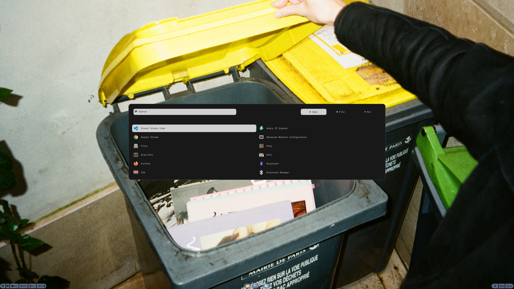
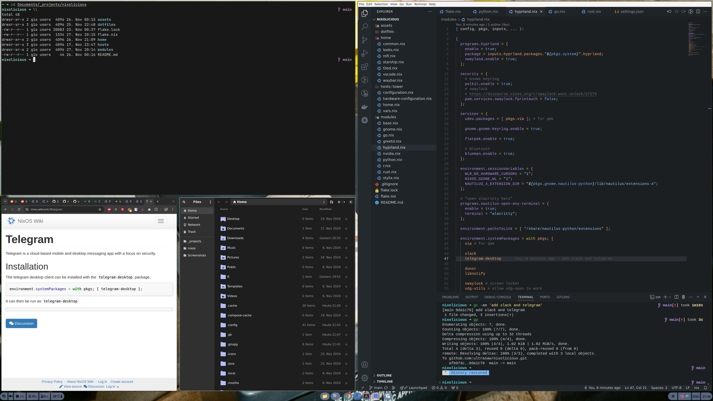
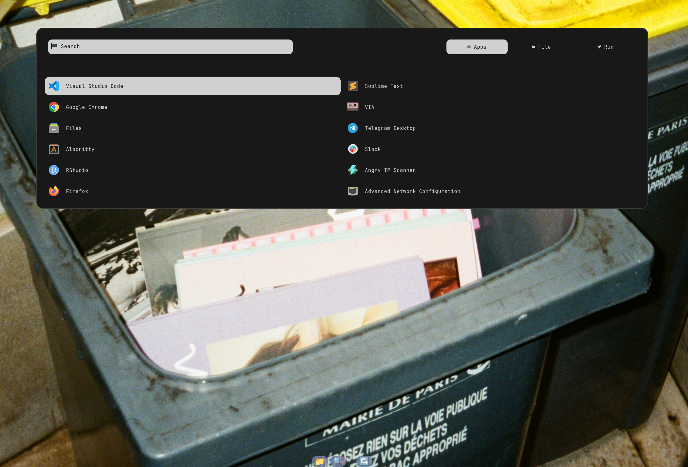

# nixolicious

## what's inside
- browser - chrome, firefox
- text editor / IDE - helix, vscode, obsidian
- talking - telegram, slack
- coding - golang, rust, python
- dev tools - docker, kubectl, k9s, opentofu
- shell - zsh + oh-my-zsh + starship
- terminal emulator - kitty (I have two cats now, so alacritty had to go)
- compositor & related - niri; rofi, waybar, nautilus
- misc - zellij, eza, zoxide, ripgrep, fzf, yazi, bat

## showcase




## commands

```bash
sudo nixos-rebuild switch --flake .#tower
sudo nixos-rebuild boot --flake .#tower # build the new configuration and make it the boot default, but do not activate it.
sudo nixos-rebuild build --flake .#tower # neither activate it nor add it to the GRUB boot menu.
sudo nixos-rebuild switch --flake .#tower --repair # repair corrupted store paths.

sudo nix-env -p /nix/var/nix/profiles/system --delete-generations +10
sudo nix-collect-garbage --delete-old
sudo nix-store --delete --ignore-liveness
```

### Resend CLI

`modules/resend.nix` checks npm for the latest Resend CLI on every system
activation (including unchanged switches and boots). It installs as `gio` into
`~/.local/share/resend-cli`, outside the Nix store, so Nix rollbacks do not roll
back this CLI. Build-only commands do not update it.

Run `resend-update` to retry an offline/failed update manually. Updates are
tested before becoming active, and previous releases are retained. Authenticate
separately with `resend login` or `RESEND_API_KEY`; no credentials belong in Nix.

### GPG signing

Boot opens swaylock automatically; entering your password unlocks the login keyring for Chrome and GPG until reboot.

Once: in Seahorse, make the login keyring the default and match its password to your login password; sign once on the desktop and save the GPG passphrase in the password manager.

Over SSH before the first desktop unlock, run inside a repo with `user.signingkey` configured (cached until reboot or GPG agent restart):

```bash
GPG_TTY="$(tty)" gpg --pinentry-mode loopback --local-user "$(git config user.signingkey)" --yes --output /dev/null --sign /dev/null
```

## extras
Hyprland and Gnome also available; edit the following:
- `flake.nix` - `nixosConfiguration.<HOST>` section in order to include the necessary modules;
- `hosts/<HOST>/home.nix` - `imports` to include the user environment modules & settings.
